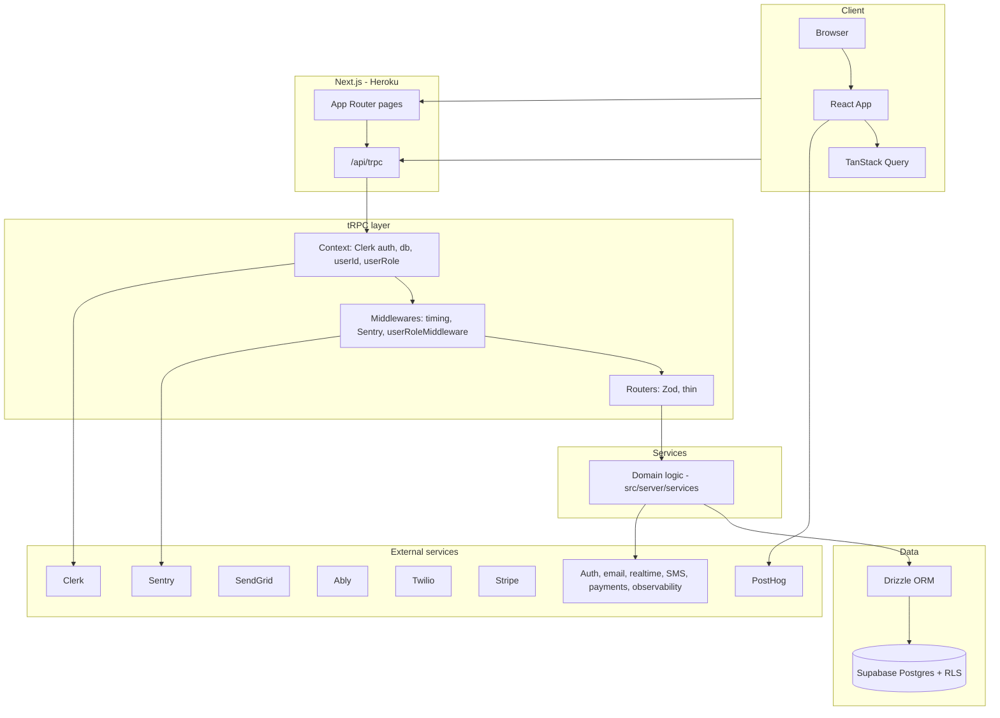
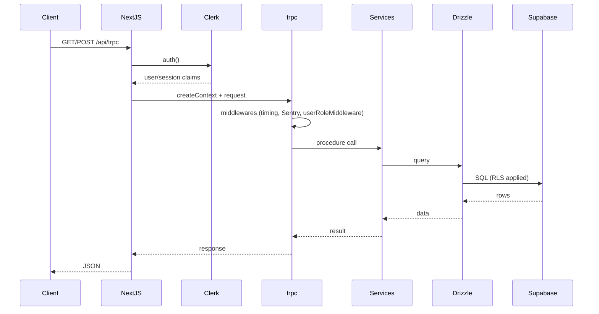

# Application architecture

This doc describes the main layers of the WFC app and how requests flow: client → Next.js (pages or tRPC API) → tRPC context and routers → services → database. External services are used for auth, email, realtime, SMS, payments, and observability.

**Request flow:** Client (React + TanStack Query) → Next.js `/api/trpc` → tRPC (context from Clerk → middlewares → routers) → services → Drizzle → Supabase; external services are used from the app or from the services layer.

## Request flow (sequence)

One API request from the client through to the database:

- **RLS:** `userRoleMiddleware` sets `request.jwt.claims` and `SET ROLE` per request so Supabase RLS policies can use role/claims.
- **External services** are invoked from services or from the app (e.g. Stripe webhooks, PostHog in layout). For how each major integration works in code, see [Third-party integrations](third-party-services/README.md). For account access and setup, see [Third-party services and handoff](third-party-services/third-party-services-integrations-handoff.md).
