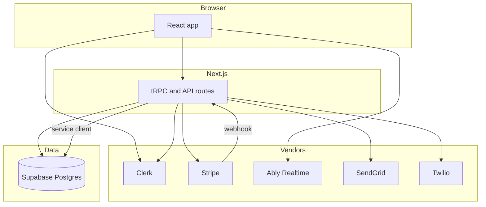

# Third-party integrations (in-app)

This folder explains **how each external service is used in the codebase**: data flows and entry files. It complements the [account handoff checklist](third-party-services-integrations-handoff.md), which covers ownership, dashboards, transfer steps, and [environment variables](third-party-services-integrations-handoff.md#environment-variables) (Heroku backup, schema in [`src/env.js`](../../src/env.js)). Hosting-oriented config is summarized in [Infrastructure](../infrastructure.md).

For the full documentation index, see [Documentation index](../README.md).

## Guides

| Doc | Service | Summary |
| --- | ------- | ------- |
| [Supabase](supabase.md) | Supabase | Hosted Postgres; Drizzle + RLS; service/browser/server JS clients. |
| [Clerk](clerk.md) | Clerk | Auth; `user_id` / `user_role` claims → tRPC → RLS. |
| [Stripe](stripe.md) | Stripe | Connect, PaymentIntents on connected accounts, application fees, webhooks → `payment_logs`. |
| [Ably](ably.md) | Ably | Client Realtime pub/sub per channel; persistence via tRPC. |
| [SendGrid](sendgrid.md) | SendGrid | Transactional email (`@sendgrid/mail`). |
| [Twilio](twilio.md) | Twilio | Outbound SMS (`messages.create`). |
| [Handoff checklist](third-party-services-integrations-handoff.md) | All services | Access transfer, estimates, env backup. |

## Other accounts (no separate in-app guide)

These are configured and handed off via the [handoff checklist](third-party-services-integrations-handoff.md) but do not have a dedicated “usage in code” page in this folder:

- **Sentry** and **PostHog** — error and product analytics; env vars and wiring are covered in [Infrastructure](../infrastructure.md) and [`src/env.js`](../../src/env.js).
- **Google Cloud** and **Google Search Console** — OAuth for Sign in with Google (Clerk) and search indexing; see handoff §8–9.

## Suggested reading order (new developers)

1. [Clerk](clerk.md) and [Supabase](supabase.md) — how identity reaches Postgres and RLS.
2. [Stripe](stripe.md) — payments and how webhooks write bypassing RLS.
3. [Ably](ably.md) — realtime vs database source of truth.
4. [SendGrid](sendgrid.md) and [Twilio](twilio.md) — outbound notifications.

Then skim [Application architecture](../architecture-diagram.md) and [Database](../database.md) for the full stack.

## How services connect (high level)

Clerk does not call Supabase directly; the app sets DB session claims from Clerk after `auth()`. Ably delivers realtime messages; **writes** to `channel_messages` go through tRPC after messages are received on the client. Stripe webhooks hit a dedicated route that uses the **Supabase service role** client to update `payment_logs`.
