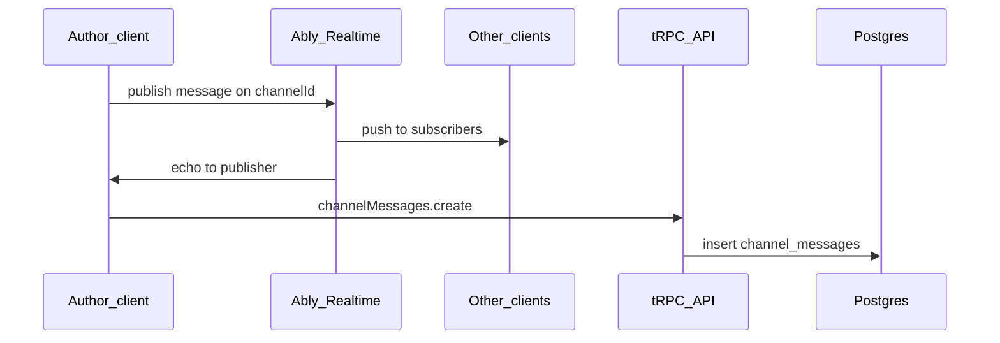

# Ably in this app

The app uses **Ably Realtime** on the **client only** (`Ably.Realtime` + `ably/react`) for **pub/sub messaging** per **channel**. Channel names match **database channel ids**. Message text is **persisted in Postgres** via **tRPC** (`channelMessages.create`), not via Ably server-side APIs.

For account transfer and dashboard, see [Third-party services and handoff](third-party-services-integrations-handoff.md#7-ably).

## What we use

| Piece | Role |
| ----- | ---- |
| **Realtime client** | `NEXT_PUBLIC_ABLY_API_KEY`; singleton helper [`getAblyInstance`](../../src/lib/ably/ably.ts) with optional `clientId` (logged-in user id). |
| **`AblyProvider`** | Supplies the Realtime client to React ([`messaging-provider.tsx`](../../src/providers/messaging-provider.tsx)). |
| **Channels** | `client.channels.get(channelId)` where `channelId` is the DB channel row id. |
| **Event name** | Subscribers listen on event **`message`**; publishers use `publish("message", payload)`. |
| **Payload shape** | [`AblyMessagePayload`](../../src/types/ably.ts): `channelId`, `message`, `userId`. |

## Persistence model (important)

1. A user **publishes** a message on the Ably channel.
2. **Subscribers** (including other participants) receive it in real time.
3. The **author’s client** handles the incoming message and, when the payload is from the same user, calls **tRPC** `channelMessages.create` to write **`channel_messages`** (including `ably_message_id` and `ably_raw_message`).

So Ably is the **real-time transport**; **source of truth** for history is the database.

## Where in code

| Path | Purpose |
| ---- | ------- |
| [`src/lib/ably/ably.ts`](../../src/lib/ably/ably.ts) | Realtime client factory. |
| [`src/providers/messaging-provider.tsx`](../../src/providers/messaging-provider.tsx) | Connect/disconnect; `AblyProvider`. |
| [`src/hooks/use-messaging.tsx`](../../src/hooks/use-messaging.tsx) | Subscribe/publish, connection handling, `channelMessages.create` on author path. |
| [`src/server/db/schema/channel-messages.ts`](../../src/server/db/schema/channel-messages.ts) | `ably_message_id`, `ably_raw_message` columns. |

## Flow (diagram)

## Related

- [Supabase](supabase.md) / [Database](../database.md) — `channels` and `channel_messages`.
- [Clerk](clerk.md) — user id for client identity and API auth.
