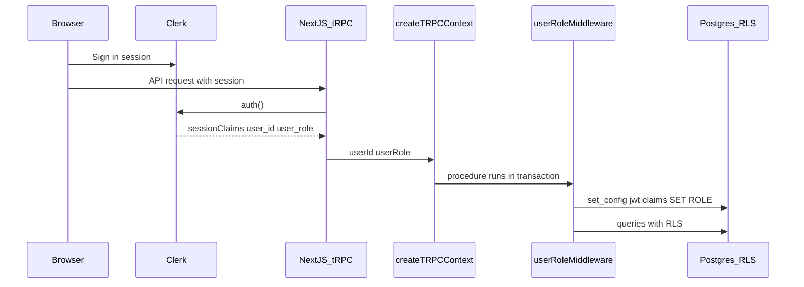

# Clerk in this app

Clerk provides **authentication and sessions** for the Next.js app. The backend does not use Clerk’s session only for “logged in or not”: it maps Clerk session claims into **app user id and role**, which drive **Supabase RLS** via Drizzle (see [Supabase](supabase.md)).

For dashboard setup, custom claims, Google Sign-In, and handoff, see [Third-party services and handoff](third-party-services-integrations-handoff.md#4-clerk).

## What we use

| Piece | Role |
| ----- | ---- |
| **`ClerkProvider`** | Wraps the React tree (root layout). |
| **`auth()`** (`@clerk/nextjs/server`) | Resolves the current session on the server when building tRPC context. |
| **Custom session claims** | `user_id` and `user_role` — must be configured in the Clerk dashboard (JWT template / session claims). These are read in code as `sessionClaims?.user_id` and `sessionClaims?.user_role`. |

## What is configured outside the repo

- Session custom claims so **`user_id`** and **`user_role`** are present on the session.
- Sign-in URLs, domains, and **Sign in with Google** (OAuth credentials may live in Google Cloud; see handoff § Google Cloud).

## Where in code

| Path | Purpose |
| ---- | ------- |
| [`src/app/layout.tsx`](../../src/app/layout.tsx) | `ClerkProvider` and related app shell. |
| [`src/app/api/trpc/[trpc]/route.ts`](../../src/app/api/trpc/%5Btrpc%5D/route.ts) | `auth()` → passes `userId` / `userRole` from claims into `createTRPCContext`. |
| [`src/trpc/server.ts`](../../src/trpc/server.ts) | Same pattern for server-side tRPC callers. |
| [`src/server/api/core.ts`](../../src/server/api/core.ts) | `createTRPCContext` shape (`userId`, `userRole`). |
| [`src/server/api/middlewares/user-role-middleware.ts`](../../src/server/api/middlewares/user-role-middleware.ts) | Writes `user_role` into DB session for RLS. |

## Session to database (diagram)

## Related

- [Supabase](supabase.md) — RLS and Drizzle.
- [Codebase](../codebase.md) — security and prerequisites.
- [Application architecture](../architecture-diagram.md) — full stack diagram.
