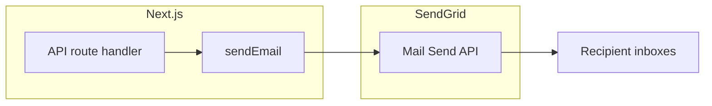

# SendGrid in this app

SendGrid is used only for **transactional outbound email** via the **`@sendgrid/mail`** SDK (`sendMultiple`). There is a single shared implementation; multiple **Next.js API routes** call it for different email types (welcome, documents, announcements, etc.).

For WFC account access and delivery monitoring, see [Third-party services and handoff](third-party-services-integrations-handoff.md#11-sendgrid).

## What we use

| Piece | Role |
| ----- | ---- |
| **Mail Send API** | `sgMail.sendMultiple` after `setApiKey`. |
| **From address** | Fixed: `WFCentral@wfchocolate.com` with display name from `APP_NAME` by default. |
| **Tracking** | Click tracking **disabled** in code (`trackingSettings.clickTracking.enable: false`). |

## Where in code

| Path | Purpose |
| ---- | ------- |
| [`src/server/services/email-messaging/email-messaging-send-email.ts`](../../src/server/services/email-messaging/email-messaging-send-email.ts) | `sendEmail` helper (HTML, attachments, cc, etc.). |
| [`src/app/api/email/send/`](../../src/app/api/email/send/) | Route handlers per use case, for example: `welcome`, `welcome-parent`, `announcement`, `document`, `qrcode`, `signed-permission-slip`, `request-chocolate`, and signup flows that notify org admins. |

Browse that directory for the full list of routes.

## Flow (diagram)

## Related

- [Twilio](twilio.md) — SMS counterpart.
- [Codebase](../codebase.md) — API conventions for routes.
