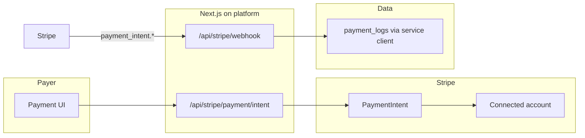

# Stripe in this app

The app uses **Stripe Connect**: each **organization** can have a **connected account** (`stripe_connected_account_id`). Charges are **PaymentIntents on the connected account** with an **application fee** to the platform. **Webhooks** sync payment outcomes into **`payment_logs`** in Postgres (via the Supabase service client, bypassing RLS).

For WFC account access and webhook monitoring in the dashboard, see [Third-party services and handoff](third-party-services-integrations-handoff.md#10-stripe).

## What we use

| Product / feature | Use in codebase |
| ----------------- | --------------- |
| **Connect — connected accounts** | Create/update Express-style accounts; store id on organization; capabilities `card_payments`, `transfers`. |
| **PaymentIntents (Connect)** | Created **on the connected account** (`stripeAccount` option) with `application_fee_amount` for platform fee. |
| **Account Sessions** | Embedded Connect UI (onboarding, account management, balances, payouts, payment details). |
| **Webhooks** | `payment_intent.succeeded`, `payment_intent.payment_failed`, `payment_intent.processing` → upsert `payment_logs`. |
| **Stripe.js (client)** | Publishable key + Elements-style checkout flows wrapped in providers/components. |

Fee calculation uses [`getPaymentApplicationFeeAmount`](../../src/constants/stripe) (MCC and payment method aware).

## Where in code

| Path | Purpose |
| ---- | ------- |
| [`src/lib/stripe/stripe.ts`](../../src/lib/stripe/stripe.ts) | Shared `Stripe` client instance. |
| [`src/app/api/stripe/account/route.tsx`](../../src/app/api/stripe/account/route.tsx) | Create connected account (REST) + `accounts.update` (profile, capabilities). |
| [`src/app/api/stripe/account-session/route.tsx`](../../src/app/api/stripe/account-session/route.tsx) | `accountSessions.create` for embedded components. |
| [`src/app/api/stripe/payment/intent/route.ts`](../../src/app/api/stripe/payment/intent/route.ts) | Create/update PaymentIntents on connected account + metadata for webhook. |
| [`src/app/api/stripe/payment/verification/route.ts`](../../src/app/api/stripe/payment/verification/route.ts) | Retrieve PaymentIntent on connected account. |
| [`src/app/api/stripe/webhook/route.ts`](../../src/app/api/stripe/webhook/route.ts) | Webhook handler → `payment_logs`. |
| [`src/providers/stripe-connect-provider.tsx`](../../src/providers/stripe-connect-provider.tsx) | Client Stripe wiring. |
| [`src/components/payment/`](../../src/components/payment/) | Checkout and PIN flows. |
| [`src/components/stripe-connect/`](../../src/components/stripe-connect/) | Connect entry UI. |

## End-to-end flow (diagram)

## Related

- [Supabase](supabase.md) — service role client and RLS vs bypass.
- [Application architecture](../architecture-diagram.md) — external services in the big picture.
