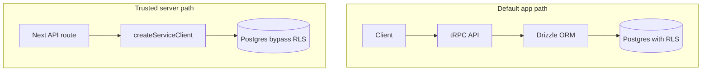

# Supabase in this app

Supabase hosts **Postgres** for this project. The app uses it as the primary data store with **Row Level Security (RLS)**; most reads and writes go through **Drizzle ORM**, not Supabase’s auto-generated REST API.

For schema, migrations, RLS, `authorize()`, and the full client comparison table, see [Database](../database.md). For account access and project transfer, see [Third-party services and handoff](third-party-services-integrations-handoff.md#3-supabase).

## What we use

| Piece | Role |
| ----- | ---- |
| **Postgres** | All application data; Drizzle connects with `DATABASE_URL`. |
| **RLS** | Enforced on app tables; policies use `public.authorize(...)` and JWT claims set per request (see [Clerk](clerk.md)). |
| **Supabase JS (anon + SSR)** | Storage and a few server flows that need the cookie-aware client—not the default for table CRUD. |
| **Supabase JS (service role)** | Trusted server code that must bypass RLS (e.g. Stripe webhook updating `payment_logs`). |

## Where in code

| Path | Purpose |
| ---- | ------- |
| [`src/server/db/index.ts`](../../src/server/db/index.ts) | Drizzle + `postgres` using `DATABASE_URL`. |
| [`src/server/api/middlewares/user-role-middleware.ts`](../../src/server/api/middlewares/user-role-middleware.ts) | Sets `request.jwt.claims` and Postgres role so RLS sees `user_role` (from Clerk). |
| [`src/lib/supabase/service-client.ts`](../../src/lib/supabase/service-client.ts) | `createServiceClient()` — bypasses RLS. |
| [`src/lib/supabase/client.ts`](../../src/lib/supabase/client.ts), [`server.ts`](../../src/lib/supabase/server.ts) | Anon-key clients for Storage / SSR. |

## Data access paths (diagram)

Examples of the bypass path: [`src/app/api/stripe/webhook/route.ts`](../../src/app/api/stripe/webhook/route.ts) writing `payment_logs`.

## Related

- [Clerk](clerk.md) — how `user_id` / `user_role` reach the DB session.
- [Stripe](stripe.md) — webhook → service client → `payment_logs`.
- [Application architecture](../architecture-diagram.md) — overall request flow.
