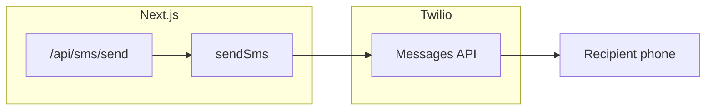

# Twilio in this app

Twilio is used for **Programmable SMS** only: a small server helper creates outbound **messages** with the **Messages API** (`messages.create`).

For WFC account access, phone number, and team invites, see [Third-party services and handoff](third-party-services-integrations-handoff.md#12-twilio).

## What we use

| Piece | Role |
| ----- | ---- |
| **Twilio Node SDK** | `Twilio(accountSid, authToken)` per send in [`sms-messaging-send-sms.ts`](../../src/server/services/sms-messaging/sms-messaging-send-sms.ts). |
| **SMS** | `client.messages.create({ body, to, from })` using env-configured **from** number. |

## Where in code

| Path | Purpose |
| ---- | ------- |
| [`src/server/services/sms-messaging/sms-messaging-send-sms.ts`](../../src/server/services/sms-messaging/sms-messaging-send-sms.ts) | `sendSms(to, message)`. |
| [`src/app/api/sms/send/route.ts`](../../src/app/api/sms/send/route.ts) | HTTP entry that invokes `sendSms`. |

## Flow (diagram)

## Related

- [SendGrid](sendgrid.md) — email counterpart.
- [Codebase](../codebase.md) — API response patterns.
